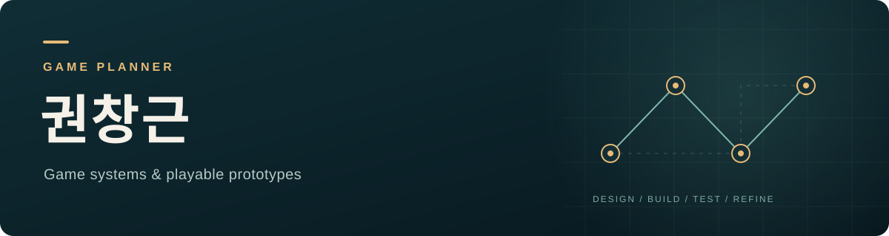

# 게임 기획자 권창근

게임의 규칙과 플레이어의 선택을 설계합니다.  
기획을 프로토타입으로 옮기고, 플레이 결과를 바탕으로 수정하는 과정을 기록합니다.

[공개 프로젝트](#공개-프로젝트) · [작업 방식](#작업-방식) · [사용 도구](#사용-도구) · [LinkedIn](https://www.linkedin.com/in/harua1210)

---

## 기획에서 살펴보는 것

- **규칙과 시스템** — 목표, 행동, 자원, 승패 조건이 어떻게 연결되는지 정리합니다.
- **수치와 예외** — 구현할 때 해석이 갈리지 않도록 조건과 판정 순서를 구체화합니다.
- **플레이어의 선택** — 어떤 선택이 생기고, 무엇이 혼란스럽거나 반복적으로 느껴지는지 확인합니다.

## 작업 방식

| 단계 | 남기는 기록 |
| :--- | :--- |
| 기획 | 목표 경험, 핵심 규칙, 수치, 예외 조건 |
| 구현 | 프로토타입 범위와 실제 구현된 기능 |
| 테스트 | 재현 순서, 플레이 관찰, 자동 검증 결과 |
| 수정 | 변경 이유, 유지할 조건, 다음 확인 사항 |

### AI와 함께하는 개발 기록

저는 **기획 방향과 변경 판단, 직접 플레이 테스트**를 맡고, AI를 **구현과 수정의 도구**로 활용하는 개발 과정을 시작했습니다.

기획자의 결정과 AI의 구현 기여를 구분해서 기록합니다. 자동 테스트 통과와 실제 플레이의 재미도 별도로 확인합니다.

## 공개 프로젝트

### [ChessGame](https://github.com/ckdrms0113/ChessGame)

체스 규칙 구현과 구조 설계를 주제로 한 프로젝트입니다.  
현재 공개 저장소에 코드가 있으며, 기획 의도와 개발 과정을 설명하는 문서는 보강할 예정입니다.

### [Check the King](https://github.com/ckdrms0113/ChecktheKing)

카드 기반 전략 게임의 시스템 설계 프로젝트입니다.  
**저장소 준비 단계**로, 현재 공개 저장소에는 코드가 등록되어 있지 않습니다.

## 사용 도구

**기획·정리**　Notion  
**구현·실험**　Python · C# · Unity  
**버전 관리**　Git · GitHub

---

## 연결

[LinkedIn에서 더 알아보기](https://www.linkedin.com/in/harua1210)
